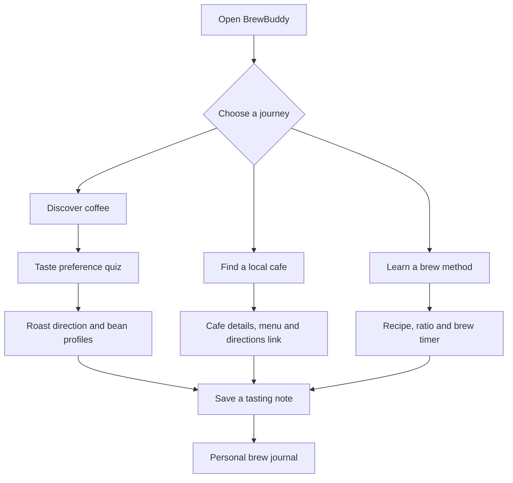
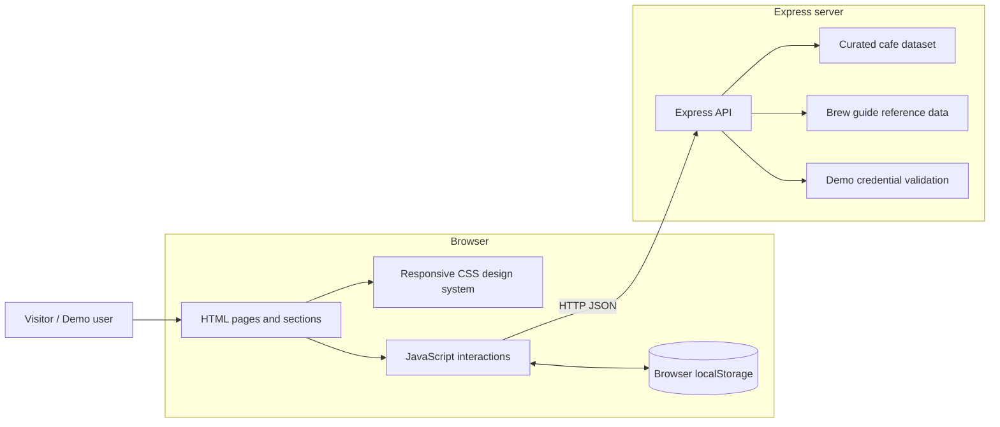

<div align="center">


# ☕ BrewBuddy
### Discover your taste. Find your coffee. Make every cup count.

<p>
  <a href="https://github.com/Adarsh-Singh-Chauhan/BrewBuddy-Coffee-App"></a>
  
  
  
  
</p>

[Explore the repository](https://github.com/Adarsh-Singh-Chauhan/BrewBuddy-Coffee-App) · [Read the setup guide](#-getting-started) · [Report an issue](https://github.com/Adarsh-Singh-Chauhan/BrewBuddy-Coffee-App/issues)

</div>

---

## The idea

Coffee discovery is often fragmented. Someone may know the drink they like but not the roast profile behind it, struggle to repeat a good brew, or have no simple way to compare local cafes and keep tasting notes.

**BrewBuddy brings those small parts of the coffee journey into one companion:** explore roast profiles, get a taste-based starting point, browse a curated Bhopal cafe directory, follow practical brew recipes, and keep a personal brew journal.

> BrewBuddy is a coffee discovery and education prototype. Recommendations are rule-based, cafe entries are curated demo content, and the profile/journal in the current demo are stored in the browser.

## Product workflow



## What you can do

| Area | Included experience | Current implementation |
|---|---|---|
| Coffee discovery | Coffee profiles, roast styles, tasting notes and brew suggestions | Curated front-end data |
| Taste matching | Short preference quiz with a roast direction | Rule-based JavaScript logic |
| Cafe discovery | Bhopal cafe directory, details, menu snippets, map/directions links | Express `GET /api/cafes` + curated data |
| Brew education | V60, French Press, Moka Pot and AeroPress recipes | Recipe cards and modal guides |
| Brew timer | Start, pause and reset a recipe timer | Browser JavaScript timer |
| Brew journal | Coffee name, method, rating and tasting note | Browser `localStorage` in demo mode |
| Demo profile | Sample sign-in to explore profile-gated demo actions | Client-side demo profile; not production authentication |
| BrewBot | Coffee-related prompts and local guidance | Rule-based/local knowledge responses |
| User guide | Guided product workflow and illustrative workspace preview | Static guide section with live journal counters |

## The experience

### 1. Discover

Explore coffee profiles by roast direction and flavour notes. The taste quiz uses the selected preferences to provide a practical starting point—not a machine-learning prediction.

### 2. Find a cafe

Browse the curated Bhopal directory, inspect available demo menu information and open the relevant directions/search link. Cafe details and menu values are sample content and should be verified with the venue before a visit.

### 3. Learn to brew

The guide cards provide a baseline ratio, water quantity and timing for four methods. Open a recipe to see the sequence and use its built-in timer.

### 4. Keep a brew journal

After entering demo mode, record a coffee, method, rating and tasting note. The current implementation saves these entries to the browser's local storage. They are not synced to another device or a server.

### 5. Ask BrewBot

BrewBot helps with the coffee information included in the app. The current repository does not contain a configured OpenAI, Gemini or Claude API integration, so the UI does not claim live multi-model inference.

## Architecture



### Repository structure

```text
BrewBuddy-Coffee-App/
├── index.html       # Page structure, discovery sections, modals and guide
├── styles.css       # Visual system, responsive layouts and interactions
├── script.js        # Navigation, quiz, cafe UI, demo profile, journal and timer
├── server.js        # Express server and JSON API endpoints
└── README.md        # Product, architecture, setup and feature documentation
```

## Technology stack

| Layer | Technology | Responsibility |
|---|---|---|
| Markup | HTML5 | Semantic page structure, sections, forms and dialogs |
| Styling | CSS3 | Responsive layout, typography, design tokens, animation and component states |
| Client logic | Vanilla JavaScript (ES6+) | Navigation, quiz, cafe rendering, demo session, journal and brew timer |
| Server | Node.js | JavaScript runtime |
| HTTP API | Express | Health, cafes, demo-session and brew-guide endpoints |
| Cross-origin middleware | CORS | API cross-origin policy (currently permissive for this prototype) |
| Browser storage | localStorage | Demo profile and brew journal on the current device |
| Maps | Google Maps search/embed links | Cafe location discovery; no live ride-booking API is integrated |

No React, Next.js, Tailwind, database ORM or AI model SDK is currently used in this repository.

## API reference

Run the Express server locally and use these endpoints:

| Method | Endpoint | Purpose |
|---|---|---|
| `GET` | `/api/health` | Service health and demo-mode status |
| `GET` | `/api/cafes` | Curated cafe directory |
| `GET` | `/api/brew-guides` | Brew-method reference data |
| `POST` | `/api/demo/session` | Validate the sample demo credentials |

Example health response:

```json
{
  "success": true,
  "service": "BrewBuddy",
  "status": "ok",
  "mode": "demo"
}
```

Example demo-session request:

```bash
curl -X POST http://localhost:3000/api/demo/session \
  -H "Content-Type: application/json" \
  -d '{"email":"demo@brewbuddy.app","password":"BrewBuddy2026!"}'
```

The demo-session endpoint validates sample credentials and returns a demo user response. It does not create a secure session cookie, issue a token, or establish production identity.

## Demo access

The current browser demo accepts:

| Field | Value |
|---|---|
| Email | `demo@brewbuddy.app` |
| Password | `BrewBuddy2026!` |

**Demo limitations:** the client demo profile is stored in `localStorage`; it is not a real user account. The password is intentionally public and must never be reused for a real service. Do not use real personal information in this demo.

## Getting started

### Requirements

- Node.js 18 or newer
- npm
- A terminal

### Install and run

```bash
git clone https://github.com/Adarsh-Singh-Chauhan/BrewBuddy-Coffee-App.git
cd BrewBuddy-Coffee-App
npm install
```

The repository currently has no `package.json`. Install the runtime dependencies directly:

```bash
npm install express cors
node server.js
```

Open:

- Frontend: [http://localhost:3000](http://localhost:3000)
- Health: [http://localhost:3000/api/health](http://localhost:3000/api/health)
- Cafes: [http://localhost:3000/api/cafes](http://localhost:3000/api/cafes)
- Brew guides: [http://localhost:3000/api/brew-guides](http://localhost:3000/api/brew-guides)

The Express server serves the root-level `index.html`, `styles.css` and `script.js` as static files.

## Configuration and production readiness

There are no required API keys for the current local demo. Optional external integrations are not configured in source.

Before a public production launch, the following work is still required:

1. Replace demo profile handling with a real authentication provider (secure password hashing or a managed identity provider, session cookies, CSRF protections, rate limits and account recovery).
2. Add a persistent database and migrations for users, taste profiles, cafes, favourites and brew journal entries.
3. Move journal/profile writes from browser storage to authenticated API endpoints with server-side validation and ownership checks.
4. Add verified cafe data and a process for keeping menu, address and opening-hour details up to date.
5. Configure real maps/places and ride-provider integrations only where approved API access is available.
6. Add a server-side AI provider integration, secret management, usage limits and clear AI provenance before describing BrewBot as model-powered.
7. Add automated tests, accessibility checks, request logging, security headers and production deployment configuration.

### Environment variables

No environment variables are required by the current code. Do not put private API keys in `index.html` or `script.js`. If external providers are added, keep secret keys on the server and expose only the minimum necessary public configuration.

## Quality and accessibility notes

- Responsive navigation includes an accessible expanded state.
- Dialogs can be closed using the close controls or by clicking the backdrop.
- Reduced-motion preferences are respected in the stylesheet.
- User-generated journal text is escaped before rendering.
- Cafe and menu data are sample content, not independent evidence of current venue details.

## Roadmap

- [ ] Persistent database and schema migrations
- [ ] Secure registration, login, logout and password reset
- [ ] Server-synced taste profiles, favourites and brew journal
- [ ] Admin workflow for cafe listings and menu updates
- [ ] Verified Places/Maps integration
- [ ] Optional server-side LLM-powered BrewBot
- [ ] Automated unit, API and browser tests
- [ ] Production deployment and monitoring configuration

## Contributing

1. Fork the repository.
2. Create a feature branch.
3. Keep UI interactions keyboard-accessible and responsive.
4. Keep secrets out of commits.
5. Open a pull request with screenshots and a concise test summary.

## Author

**Adarsh Singh Chauhan**

- GitHub: [@Adarsh-Singh-Chauhan](https://github.com/Adarsh-Singh-Chauhan)
- LinkedIn: [Adarsh Singh](https://www.linkedin.com/in/adarsh-singh-5189b9283)

---

<div align="center">

**Make the everyday cup feel a little more intentional.**

Made for people who care about the coffee, not just the caffeine. ☕

</div>
